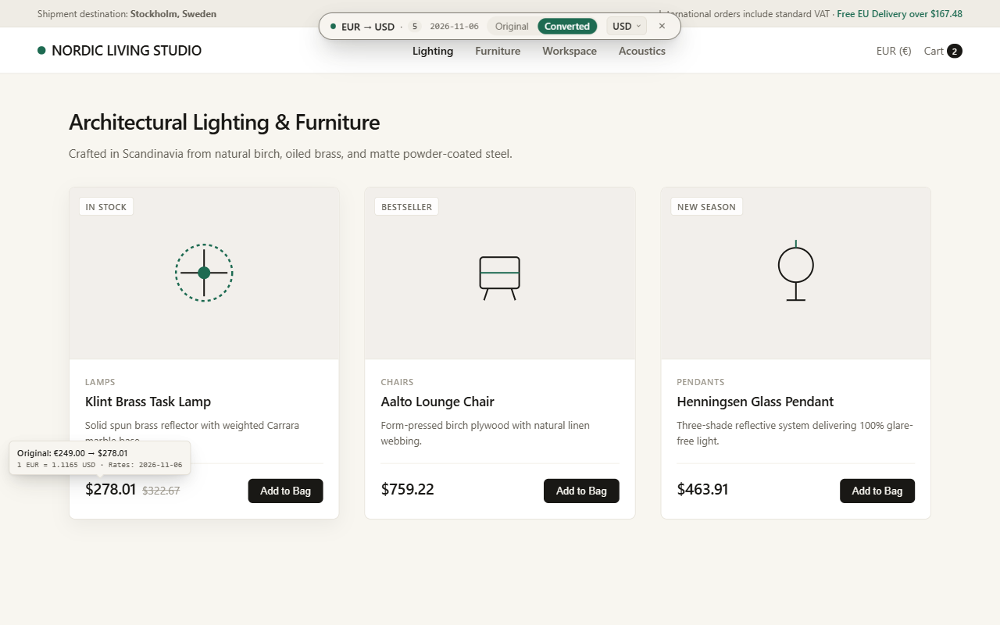
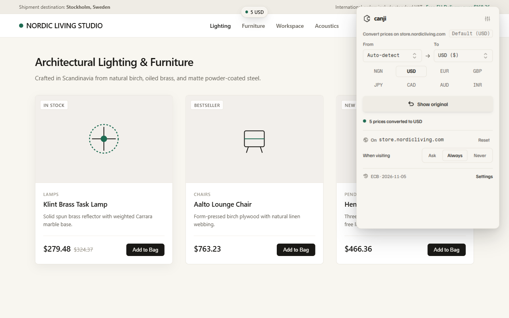
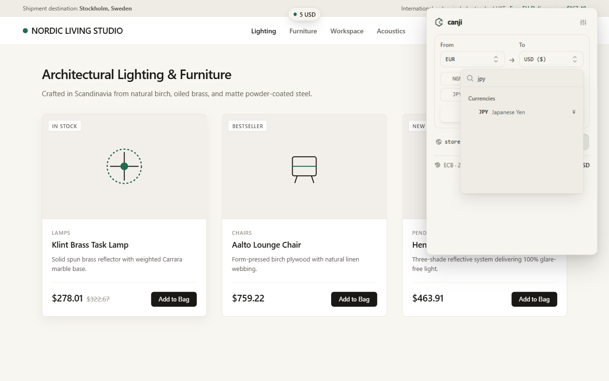
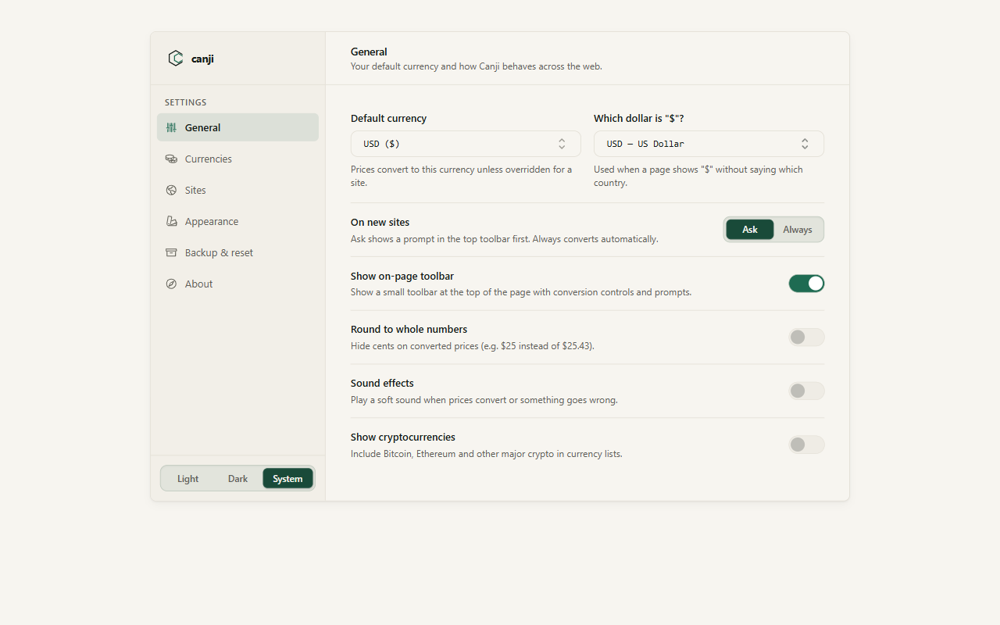
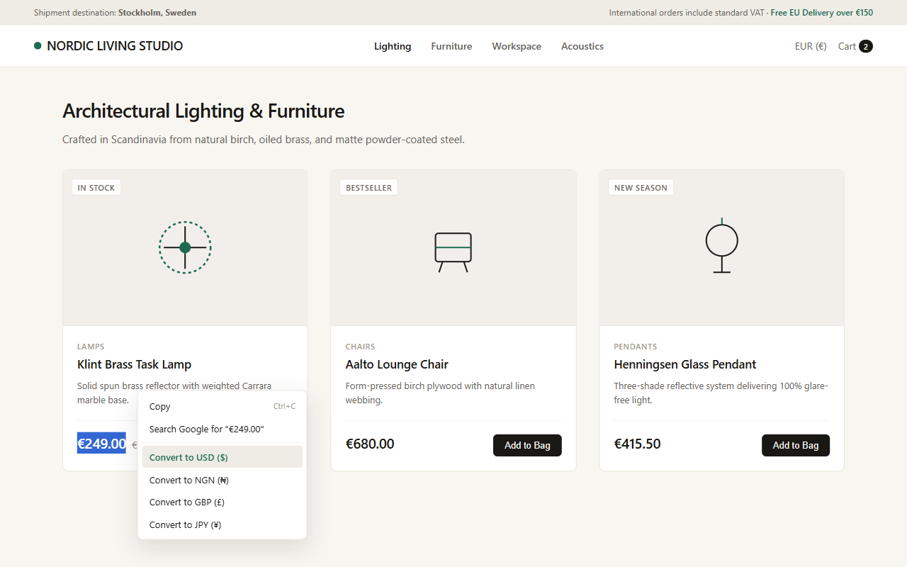
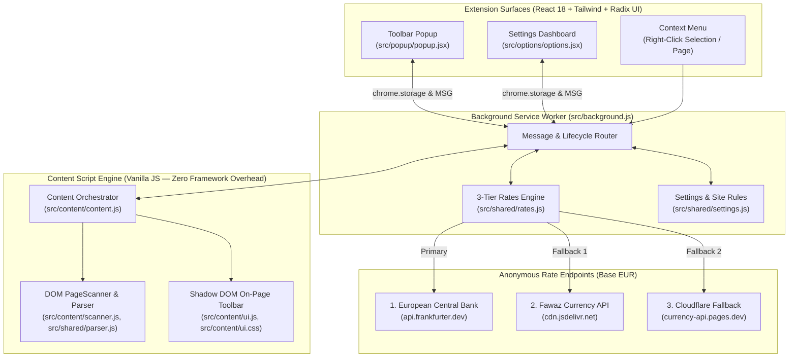

# Canji — Prices, in your currency

[](package.json)
[](https://developer.chrome.com/docs/extensions/mv3/intro/)
[](#installation--local-development)
[](LICENSE)

> **Canji** *(from Hausa `canji`, meaning change or exchange)* is a privacy-first browser extension that converts prices on international websites into your preferred currency right where they appear, with a theme-aware on-page toolbar, explicit per-site `From → To` currency rules, and instant byte-for-byte restoration of original prices.

---

## Visual Tour

### 1. In-Page Toolbar & Live Price Conversion
Prices convert directly on the page without layout shifts. A non-intrusive floating toolbar at the top of the viewport lets you switch between converted and original prices, change the target currency on the fly, or set site rules. Hovering any converted price reveals the original price and exact exchange rate used.



### 2. Toolbar Popup with Explicit `From → To` Controls
Quickly convert the active page, override both the source (**From**) and target (**To**) currencies for the current site, pick from up to 8 pinned currencies, or search across 170+ world currencies and major cryptocurrencies.

| Toolbar Popup | Searchable Currency Picker |
|:---:|:---:|
|  |  |

### 3. Settings Dashboard
Configure your default target currency, `$` disambiguation, behavior on new sites (`Ask` vs `Always`), display mode (`Replace in place`, `Beside original`, or `Replace and highlight`), pinned currencies, per-site `Convert from → to` rules, and JSON backup/restore.



### 4. Right-Click Selection Conversion
Highlight any price on a page, right-click, and convert it immediately via the browser context menu.



---

## Key Features

- **In-Place Page Conversion**: Converts detected prices across the page without breaking page layouts or typography.
- **Three Display Modes**:
  - **Replace in place** *(default)*: Swaps the price in place; hover any converted price to inspect the original amount and exchange rate.
  - **Beside original**: Keeps the original price and appends the converted amount in parentheses (e.g., `€249.00 ($277.14)`).
  - **Replace and highlight**: Swaps the price and applies a subtle Pine tint so converted prices stand out at a glance.
- **100% Byte-for-Byte Reversible**: Original text nodes and multi-element split-price DOM fragments are preserved in a `WeakMap`. Clicking **Show original** restores the exact original DOM structure.
- **Explicit Per-Site `From → To` Rules**:
  - Configure each site's behavior (`Ask`, `Always`, or `Never`), source currency (`Auto-detect` or a specific currency), and target currency (`Default` or a site-specific currency).
  - Two-way synchronized in real time between the Toolbar Popup and Settings.
- **Reliable Dynamic & SPA Support**:
  - Declarative `document_idle` execution paired with a debounced `MutationObserver` and post-hydration checks ensures prices that load asynchronously (on eBay, Amazon, or single-page applications) reliably trigger `Always` conversion or the `Ask` prompt.
- **5-Layer Currency Detection**:
  1. Unambiguous explicit tokens (`US$`, `CA$`, `AU$`, `NZ$`, `₦`, `€`, `£`, `zł`, `Kč`, `฿`, `₺`, ISO 4217 codes).
  2. Structured page metadata (JSON-LD `priceCurrency`, OpenGraph `og:price:currency`, `product:price:currency`, microdata `[itemprop="priceCurrency"]`).
  3. Country-code TLD resolution (`.co.uk` → `GBP`, `.ca` → `CAD`, `.de` → `EUR`, `.ng` → `NGN`, `.jp` → `JPY`) and `<html lang>` region tags.
  4. Per-site **Convert from** currency override.
  5. User-configurable default for bare `$` symbols (`Which dollar is "$"?`).
- **170+ Currencies & Multi-Tier Rate Engine**:
  - Supports 162 ISO 4217 fiat currencies and 14 major cryptocurrencies.
  - **Primary**: European Central Bank (ECB) reference rates via Frankfurter API.
  - **Secondary & Tertiary Fallbacks**: Open exchange-rate data (Fawaz Ahmed Currency API) via jsDelivr CDN and Cloudflare Pages, plus an embedded offline fallback table.
- **Privacy & Security by Design**:
  - **Zero Telemetry**: No analytics, tracking pixels, user accounts, or browsing history collection.
  - **Local-Only DOM Processing**: Webpage text is scanned strictly in local volatile memory and never leaves your device.
  - **Zero `innerHTML`**: All DOM nodes in the content script, popup, and settings page are constructed through safe native DOM APIs and React JSX.

---

## Architecture Overview



---

## Repository Structure

```text
canji/
├── build.js                        # esbuild bundler for Chrome & Firefox MV3 packages
├── package.json                    # Scripts, dependencies, and package metadata
├── tailwind.config.js              # Paper & Pine design tokens & Tailwind configuration
├── README.md                       # Project documentation
├── DESIGN.md                       # Paper & Pine design system specification
├── PRIVACY_POLICY.md               # Privacy policy and data handling disclosures
├── CHROMEWEBSTORE.md               # Chrome Web Store & Firefox AMO listing metadata
├── CHANGELOG.md                    # Release history
├── canji-kit/                      # Official Canji brand icons, lockups, and SVG symbols
├── screenshots/                    # Production store & documentation screenshots
├── scripts/
│   ├── capture-production-screenshots.js
│   ├── demo-store.html
│   ├── generate-currencies.js
│   └── launch-browser.js
├── src/
│   ├── background.js               # MV3 service worker (rates, menus, tab routing)
│   ├── content/
│   │   ├── content.js              # In-page lifecycle, auto-convert, and Ask observer
│   │   ├── scanner.js              # Two-phase DOM walker, split-price assembly, revert WeakMap
│   │   ├── ui.js                   # Shadow DOM on-page toolbar & hover tooltip
│   │   └── ui.css                  # Theme-aware Paper & Pine Shadow DOM stylesheet
│   ├── options/
│   │   ├── options.html
│   │   ├── options.jsx             # Settings2 sidebar + card dashboard
│   │   └── theme-boot.js           # Zero-flash pre-paint theme initializer
│   ├── popup/
│   │   ├── popup.html
│   │   ├── popup.jsx               # Toolbar popup with explicit From -> To controls
│   │   ├── popup-errors.js         # User-friendly error classification
│   │   └── theme-boot.js           # Zero-flash pre-paint theme initializer
│   ├── shared/
│   │   ├── audio.js                # Opt-in Web Audio tactile click synthesis
│   │   ├── browser.js              # Cross-browser chrome/browser API wrapper
│   │   ├── currencies-data.js      # Static metadata for 170+ fiat & crypto currencies
│   │   ├── currencies.js           # Currency lookup, TLD, and symbol resolution
│   │   ├── format.js               # Localized Intl.NumberFormat price formatting
│   │   ├── messaging.js            # Typed runtime message constants
│   │   ├── parser.js               # Multi-currency price extraction & page inference
│   │   ├── rates.js                # 3-tier rate fetching, caching, and cross-rate math
│   │   ├── settings.js             # Schema validation, migration, and site rule helpers
│   │   └── theme.js                # Light, dark, and system theme synchronization
│   └── ui/
│       ├── components/             # Shared domain & shadcn/ui primitives (Card, Sidebar, etc.)
│       ├── hooks/                  # Responsive & UI hooks
│       ├── lib/                    # Domain validation & class utilities
│       └── globals.css             # Local font faces & Paper & Pine CSS variables
└── tests/
    ├── *.test.js                   # Unit, parser, scanner, contrast, security & Firefox smoke tests
    ├── fixtures/                   # HTML fixtures for DOM & E2E verification
    └── e2e/                        # Real-browser Playwright E2E test suite
```

---

## Installation & Local Development

### Prerequisites
- **Node.js** `v18.0.0` or higher
- **Google Chrome** / Chromium or **Mozilla Firefox**
- **Playwright Chromium** (for E2E tests): `npx playwright install chromium`

### 1. Install & Build
> **Note**: `dist/` is git-ignored. Always run `npm run build` before loading the unpacked extension.

```bash
git clone https://github.com/richmondsogo/canji.git
cd canji
npm install
npm run build
```

Running `npm run build` compiles self-contained Manifest V3 bundles into:
- `dist/chrome/` — Unpacked Chromium extension
- `dist/firefox/` — Unpacked Firefox MV3 add-on
- `dist/packages/canji-chrome-v2.0.0.zip` — Chrome Web Store release archive
- `dist/packages/canji-firefox-v2.0.0.zip` — Firefox AMO release archive

### 2. Load into Chrome, Edge, or Brave
1. Open `chrome://extensions/` and enable **Developer mode**.
2. Click **Load unpacked** and select `dist/chrome`.

### 3. Load into Mozilla Firefox
1. Open `about:debugging#/runtime/this-firefox`.
2. Click **Load Temporary Add-on…** and select `dist/firefox/manifest.json`.

---

## Testing & Verification

```bash
# Run build + 126 unit, DOM, security, contrast, and Firefox smoke tests
npm test

# Run real-browser Playwright E2E test suite
npm run test:e2e

# Lint Firefox MV3 bundle for Mozilla AMO compliance
npm run lint:firefox
```

---

## Permissions Justification

| Permission | Scope | Justification |
|---|---|---|
| `storage` | API | Stores user preferences, per-site rules, and cached exchange rate tables locally (`chrome.storage.local` and `chrome.storage.session`). |
| `activeTab` | API | Allows on-demand price conversion on the active tab when triggered from the popup or context menu. |
| `scripting` | API | Ensures the content script engine is active when converting prices on an open tab. |
| `tabs` | API | Reads active tab URL/hostname to apply per-site conversion rules and detect restricted browser pages. |
| `contextMenus` | API | Registers the right-click **Convert prices on this page** and selection conversion menu items. |
| `notifications` | API | Displays the converted amount when converting highlighted text via the right-click menu. |
| `<all_urls>` | Host Permission | Enables in-page price detection and conversion across international shopping sites and fetches public exchange-rate tables. |

For full privacy details, see [PRIVACY_POLICY.md](PRIVACY_POLICY.md).

---

## License

Copyright © Richmond Olorunsogo. All rights reserved. See [LICENSE](LICENSE) for details.
