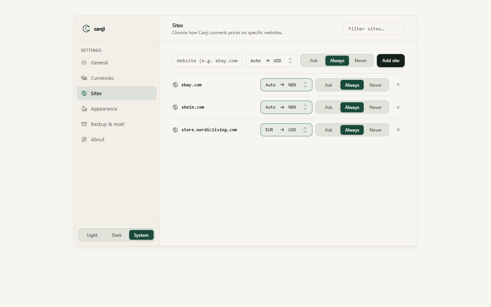
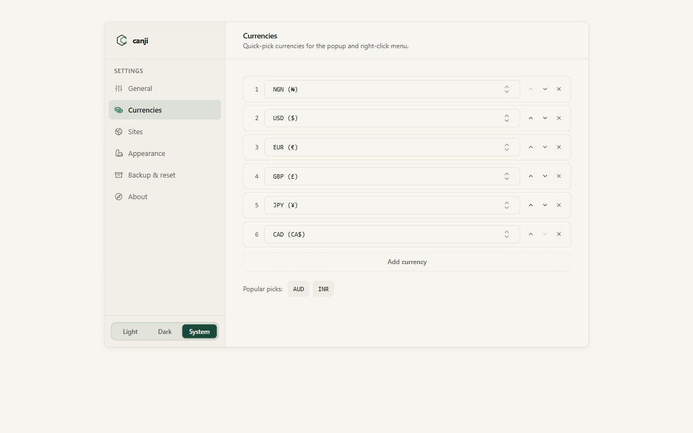
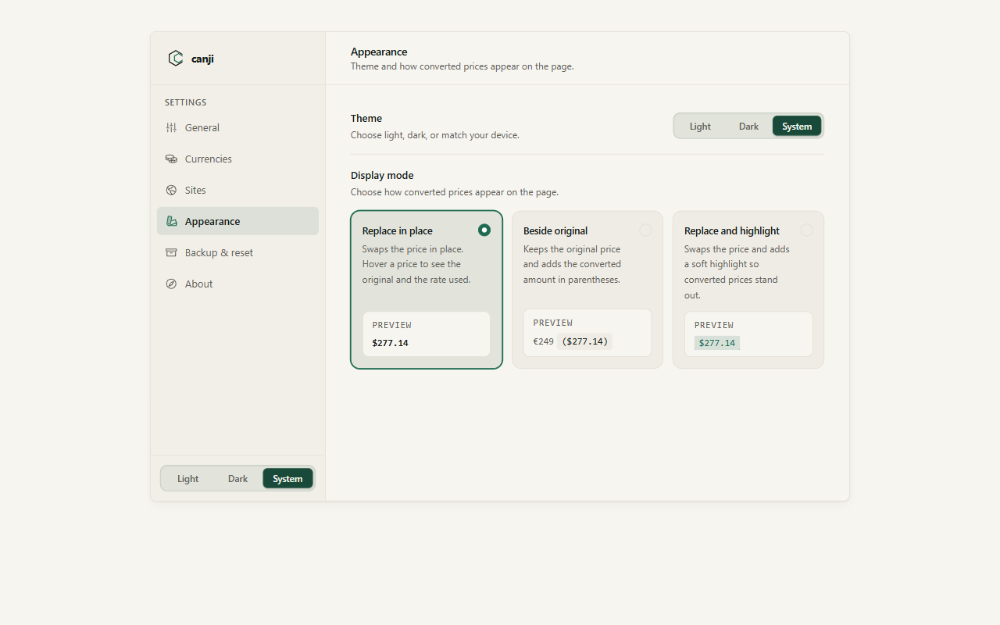
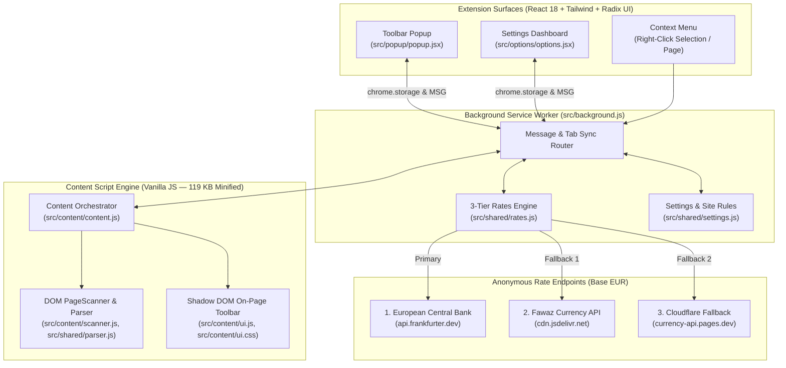

<div align="center">


# Canji

**Prices, in your currency.**  
*From Hausa `canji`, meaning change or exchange.*

[](package.json)
[](https://developer.chrome.com/docs/extensions/mv3/intro/)
[](#installation--local-development)
[](#testing--verification)
[](PRIVACY_POLICY.md)

Canji converts foreign prices on any website into your currency right where they appear—without breaking page layouts, sending your browsing history to a server, or losing the original price. Hover any converted price to see the exact exchange rate used, or click **Show original** to put every price back byte-for-byte.

</div>

---

## Visual Tour

### 1. In-Page Conversion & Floating Toolbar
When you land on an international store, Canji converts prices in place and shows a compact toolbar at the top of the page. Switch between converted and original prices, change the target currency on the fly, or hover any price on the page to inspect the original amount and exchange rate.


---

### 2. Toolbar Popup & 170+ Currency Picker
Open Canji from the browser toolbar to convert the active tab in one click, override the page's source (**From**) or target (**To**) currency, tap one of your pinned quick-pick currencies, or set the current website to **Ask**, **Always**, or **Never**.

| Toolbar Popup (`From → To` + Site Rule) | Searchable 170+ Currency Combobox |
|:---:|:---:|
|  |  |

---

### 3. Per-Site Rules (`Sites`)
Tell Canji how to handle specific websites. Set `ebay.com` or `shein.com` to **Always** convert automatically, lock a site's currency pair with the single-chip `[ Auto → NGN ⌄ ]` selector, or set local sites to **Never** so Canji stays out of the way. Changes made in the popup or in Settings sync immediately across open tabs.



---

### 4. Pinned Quick-Pick Currencies (`Currencies`)
Keep up to 8 favorite currencies in the popup and right-click menu. Swap any slot directly via its inline currency combobox, reorder rows with one click, or add from popular picks.



---

### 5. General Preferences & Display Modes (`General` & `Appearance`)
Choose your default currency, tell Canji which dollar bare `$` prices mean (`USD`, `CAD`, `AUD`, `NZD`, `SGD`, `HKD`), and pick how converted prices appear on the page: **Replace in place**, **Beside original** (`€249 ($277.14)`), or **Replace and highlight**.

| General Settings | Appearance & Display Modes |
|:---:|:---:|
|  |  |

---

### 6. Right-Click Selection Conversion
Only need to check one price? Highlight any amount on a page, right-click, and convert it into any of your pinned currencies.


---

## Why People Use Canji

- **Converts in place without breaking layouts**: Handles plain text prices (`€249.00`, `1.299,00 €`, `₦ 185,000`), split e-commerce price elements (Amazon `.a-price-whole` / `.a-price-fraction` and `<sup>` cents), price ranges (`$20 – $35`), and open Shadow DOM components.
- **100% reversible in one click**: Original text nodes and multi-element price fragments are stored in a local `WeakMap`. Clicking **Show original** restores the exact original DOM structure.
- **Three display styles**:
  - **Replace in place** *(default)* — swaps the price cleanly; hover to see the original price and exchange rate.
  - **Beside original** — keeps the original price and adds the converted amount in parentheses (`€249 ($277.14)`).
  - **Replace and highlight** — swaps the price and adds a soft Pine underline and tint so converted prices stand out at a glance.
- **5-layer currency detection**:
  1. Unambiguous symbols and prefixes (`US$`, `CA$`, `AU$`, `NZ$`, `₦`, `€`, `£`, `zł`, `Kč`, `฿`, `₺`, `₵`, `₱`, `₩`, `₹`, and ISO 4217 codes).
  2. Structured page metadata (JSON-LD `priceCurrency`, OpenGraph `og:price:currency`, `product:price:currency`, and microdata `[itemprop="priceCurrency"]`).
  3. Country-code domain and locale inference (`.co.uk` → `GBP`, `.ca` → `CAD`, `.de` → `EUR`, `.com.ng` → `NGN`, `.co.jp` → `JPY`, plus `<html lang>` tags).
  4. Per-site **Convert from** currency override.
  5. Your chosen default for bare `$` symbols (**Which dollar is "$"?**).
- **170+ currencies with a 3-tier rate engine**:
  - Supports **162 ISO 4217 fiat currencies** and **14 major cryptocurrencies**.
  - Fetches daily reference rates from the **European Central Bank** (Frankfurter API), with automatic fallback to the **Fawaz Ahmed Currency API** (jsDelivr CDN and Cloudflare Pages mirrors) plus an offline fallback table.
- **Private & secure by design**:
  - **Zero telemetry**: No analytics, tracking scripts, accounts, or browsing history collection.
  - **100% local DOM scanning**: Webpage text never leaves your browser tab.
  - **Zero `innerHTML`**: Every DOM element across the content script, popup, and settings dashboard is built with native DOM APIs (`createElement`, `textContent`) and React JSX.

---

## Architecture Overview



---

## Installation & Local Development

### Prerequisites
- **Node.js** `v18.0.0` or newer
- **Google Chrome** / Chromium or **Mozilla Firefox**
- **Playwright Chromium** (for E2E tests): `npx playwright install chromium`

### 1. Clone & Build
> [!IMPORTANT]
> `dist/` is git-ignored. Always run `npm run build` before loading the extension into your browser.

```bash
git clone https://github.com/richmondsogo/canji.git
cd canji
npm install
npm run build
```

Running `npm run build` compiles self-contained, minified Manifest V3 bundles (`~433 KB` packaged ZIP, zero external font bloat) into:
- `dist/chrome/` — Unpacked Chromium extension (`Chrome`, `Edge`, `Brave`, `Arc`, `Vivaldi`)
- `dist/firefox/` — Unpacked Firefox MV3 add-on (`Firefox 140+`)
- `dist/packages/canji-chrome-v2.0.0.zip` — Chrome Web Store release archive
- `dist/packages/canji-firefox-v2.0.0.zip` — Firefox AMO release archive

### 2. Load into Chrome, Edge, or Brave
1. Open `chrome://extensions/` and turn on **Developer mode** (top right).
2. Click **Load unpacked** and select the `dist/chrome` folder.

### 3. Load into Mozilla Firefox
1. Open `about:debugging#/runtime/this-firefox`.
2. Click **Load Temporary Add-on…** and select `dist/firefox/manifest.json`.

---

## Testing, Audits & Verification

```bash
# Build bundles + run all 134 unit, parser, scanner, contrast, security & Firefox smoke tests
npm test

# Run the 15 real-browser Playwright E2E test suites
npm run test:e2e

# Lint the Firefox MV3 bundle with Mozilla web-ext (0 errors, 0 notices)
npm run lint:firefox

# Regenerate all 9 production screenshots in screenshots/
node scripts/capture-production-screenshots.js
```

For detailed architecture, design tokens, and security/performance audit reports, see:
- [`DESIGN.md`](DESIGN.md) — **Paper & Pine** design system, Option A color tokens, WCAG contrast table, and component specs
- [`docs/audits/2026-11-07-security-performance-production-audit.md`](docs/audits/2026-11-07-security-performance-production-audit.md) — Cloudflare 6-Phase Security Audit, Performance Audit, and 20/20 Production Readiness Scorecard
- [`PRIVACY_POLICY.md`](PRIVACY_POLICY.md) — Zero-telemetry data handling and permission disclosures
- [`CHROMEWEBSTORE.md`](CHROMEWEBSTORE.md) — Chrome Web Store & Firefox AMO submission specification

---

## Permissions Justification

| Permission | Scope | Why Canji Needs It |
| :--- | :--- | :--- |
| `storage` | API | Saves your currency preferences, pinned currencies, per-site rules, and cached exchange rates locally (`chrome.storage.local` and `chrome.storage.session`). |
| `activeTab` | API | Allows on-demand price conversion on the current tab when you click **Convert** in the popup or context menu. |
| `scripting` | API | Ensures the content script engine is active on already-open tabs when you convert prices or switch a site to `Always`. |
| `tabs` | API | Reads the active tab's hostname to apply your per-site rules (`Ask`, `Always`, `Never`) and sync changes across open tabs. |
| `contextMenus` | API | Adds **Convert prices on this page** and highlighted price conversion items to the right-click menu. |
| `notifications` | API | Shows the converted amount when you convert highlighted text from the right-click menu. |
| `<all_urls>` | Host Permission | Lets the local price scanner detect and convert prices on international shopping sites and fetch public exchange-rate tables. |

---

## License

Copyright © Richmond Olorunsogo. All rights reserved. See [LICENSE](LICENSE) for details.
