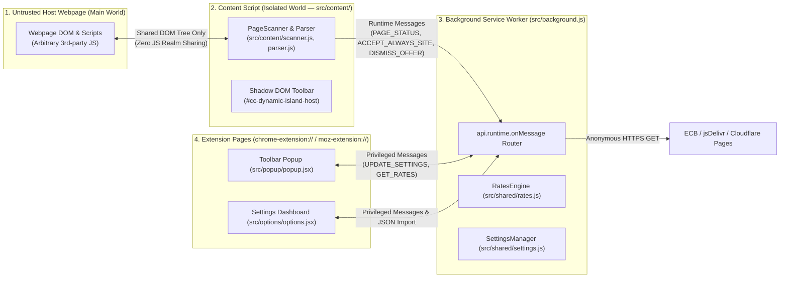

# Canji v2.0.0 — Security, Performance & Production Readiness Audit

**Date**: 2026-11-07  
**Target Repository**: `c:\Users\Richmond\Downloads\currency-converter-v2` (`canji` v2.0.0)  
**Audit Frameworks**:
- **Security**: [`cloudflare/security-audit-skill`](https://github.com/cloudflare/security-audit-skill) (6-Phase Source-First Security Audit)
- **Performance**: `/performance` (`web-quality-skills` v2.0) + `$impeccable optimize`
- **Technical Quality & Hardening**: `$impeccable audit` (5-Dimension Scorecard) + `$impeccable harden`

---

## Part 1: Cloudflare 6-Phase Security Audit (`cloudflare/security-audit-skill`)

### Phase 1: Reconnaissance & Trust Boundary Architecture

Canji operates across four distinct privilege zones in Chromium and Firefox (Manifest V3):

| Boundary ID | Lower-Trust Principal | Higher-Trust Principal / Resource | Entry Points |
| :--- | :--- | :--- | :--- |
| **TB-1** | Untrusted Host Webpage DOM | Content Script (`src/content/scanner.js`, `src/content/ui.js`) | Text nodes, split price DOM nodes, `meta` / `ld+json` tags, Shadow DOM roots |
| **TB-2** | Content Script in Web Tab (`sender.tab`) | Background Service Worker (`src/background.js`) | `api.runtime.onMessage` (`MSG.UPDATE_SETTINGS`, `MSG.ACCEPT_ALWAYS_SITE`, `MSG.DISMISS_OFFER`, `MSG.CHECK_OFFER_ELIGIBILITY`, `MSG.PAGE_STATUS`) |
| **TB-3** | User-Supplied JSON Backup File | Extension Storage & Settings State (`src/shared/settings.js`) | `#input-import-settings` → `validateImportContent` → `validateSettings` / `migrateSettings` |
| **TB-4** | External Exchange Rate APIs | Rate Cache & Price Formatter (`src/shared/rates.js`, `src/shared/format.js`) | `fetchJson` responses from `api.frankfurter.dev`, `cdn.jsdelivr.net`, `currency-api.pages.dev` |

---

### Phases 2–5: Coverage-Led Hunting, Candidate Validation & Independent Verification

#### Finding `CANJI-SEC-001` — Cross-Origin Site Rule Spoofing via `MSG.ACCEPT_ALWAYS_SITE` and `MSG.DISMISS_OFFER`
- **State**: `confirmed` (Fixed in current branch)
- **Severity**: **Medium**
- **Boundary**: `TB-2` (Content Script in Web Tab → Background Service Worker `settings.perSite`)
- **Source Evidence**:
  - Previously in [`src/background.js`](file:///c:/Users/Richmond/Downloads/currency-converter-v2/src/background.js#L350-L388), `MSG.ACCEPT_ALWAYS_SITE` and `MSG.DISMISS_OFFER` evaluated:
    `const host = normalizeHost(message.payload?.hostname || extractNormalizedHost(sender?.tab?.url));`
  - Because `message.payload?.hostname` took precedence over `sender?.tab?.url`, a compromised content script or frame in tab `evil.test` could send `{ type: MSG.ACCEPT_ALWAYS_SITE, payload: { hostname: 'amazon.com' } }` and overwrite the user's `perSite['amazon.com']` rule to `always`.
- **Remediation Applied**:
  - Added [`resolveTrustedSenderHost(sender, fallbackHostname)`](file:///c:/Users/Richmond/Downloads/currency-converter-v2/src/background.js#L146-L152) in `src/background.js`, which strictly derives the hostname from `sender.tab.url` whenever the message originates from a browser tab, ignoring any untrusted `payload.hostname`.
  - Pinned by unit test `security: resolveTrustedSenderHost binds tab messages to sender.tab.url and prevents cross-origin hostname spoofing` in [`tests/security.test.js`](file:///c:/Users/Richmond/Downloads/currency-converter-v2/tests/security.test.js#L108-L120).

#### Finding `CANJI-SEC-002` — Schema v3 JSON Import Field Bypass & Prototype Key Collision in `perSite`
- **State**: `confirmed` (Fixed in current branch)
- **Severity**: **Medium**
- **Boundary**: `TB-3` (Untrusted JSON Backup File → `migrateSettings` / `validateSettings` in `src/shared/settings.js`)
- **Source Evidence**:
  - Previously in [`src/shared/settings.js`](file:///c:/Users/Richmond/Downloads/currency-converter-v2/src/shared/settings.js#L228-L263), when `raw.schemaVersion === 3`, `migrateSettings(raw)` returned `{ ...DEFAULT_SETTINGS, ...raw, perSite: migratedPerSite }` without validating enum fields (`theme`, `displayMode`), boolean flags, or stripping arbitrary top-level properties.
  - Furthermore, `normalizeHost(k)` did not reject prototype property names (`__proto__`, `constructor`, `prototype`, `toString`, `valueOf`), and `getSiteMode` / `getSiteCurrencies` accessed `s.perSite[key]` without an `Object.prototype.hasOwnProperty.call` guard.
- **Remediation Applied**:
  - Updated [`normalizeHost`](file:///c:/Users/Richmond/Downloads/currency-converter-v2/src/shared/settings.js#L40-L67) to reject `DANGEROUS_HOST_KEYS` (`__proto__`, `constructor`, `prototype`, `tostring`, `valueof`, `hasownproperty`).
  - Added `Object.prototype.hasOwnProperty.call(s.perSite, key)` guards in [`getSiteMode`](file:///c:/Users/Richmond/Downloads/currency-converter-v2/src/shared/settings.js#L103) and [`getSiteCurrencies`](file:///c:/Users/Richmond/Downloads/currency-converter-v2/src/shared/settings.js#L138).
  - Updated [`migrateSettings`](file:///c:/Users/Richmond/Downloads/currency-converter-v2/src/shared/settings.js#L257-L278) so schema v3 objects undergo strict allowlisting and type/enum sanitization identical to v1/v2 migrations.
  - Pinned by unit test `security: normalizeHost and migrateSettings prevent prototype pollution and strip unvalidated v3 fields` in [`tests/security.test.js`](file:///c:/Users/Richmond/Downloads/currency-converter-v2/tests/security.test.js#L122-L143).

#### Finding `CANJI-SEC-003` — Explicit Manifest V3 Content Security Policy (`content_security_policy`)
- **State**: `confirmed` (Hardened in current branch)
- **Severity**: **Informational / Defense-in-Depth**
- **Source Evidence & Remediation**:
  - Added explicit `content_security_policy: { extension_pages: "script-src 'self'; object-src 'self'; base-uri 'none';" }` to `commonManifest` in [`build.js`](file:///c:/Users/Richmond/Downloads/currency-converter-v2/build.js#L298-L300) for both Chrome and Firefox builds, preventing base-URI hijacking and object embeds.
  - Pinned in [`tests/build.test.js`](file:///c:/Users/Richmond/Downloads/currency-converter-v2/tests/build.test.js#L116-L125).

#### Verified Clean Security Controls (Rejected / Zero-Vulnerability Candidates)
1. **DOM-Based XSS (`TB-1`)**: Verified **0 occurrences** of `innerHTML`, `outerHTML`, `insertAdjacentHTML`, `dangerouslySetInnerHTML`, `eval()`, or `new Function()` across `src/`. All in-page toolbar elements (`src/content/ui.js`) use `document.createElement`, `document.createElementNS`, and `textContent`.
2. **Privilege Escalation via `MSG.UPDATE_SETTINGS` (`TB-2`)**: Verified `src/background.js` enforces `sender.id === api.runtime.id` and `chrome-extension://` / `moz-extension://` URL prefix checks, rejecting content script callers (`tests/security.test.js`).
3. **Hardcoded Credentials / Secrets**: Recursive scan across all repository files confirmed **0 hardcoded API keys, tokens, or secrets** (`tests/security.test.js`).

---

## Part 2: Performance Audit (`/performance` + `$impeccable optimize`)

### 1. Bundle & Package Weight Optimization (Before vs. After)

| Artifact | Before Audit | After Audit | Delta | Optimization Applied |
| :--- | :--- | :--- | :--- | :--- |
| **`dist/packages/canji-chrome-v2.0.0.zip`** | `1,077.4 KB` | **`433.4 KB`** | **-59.8% (`-644.0 KB`)** | Cleaned 60+ dead `.woff`/`.woff2` font files & minified vanilla entry points |
| **`dist/packages/canji-firefox-v2.0.0.zip`** | `1,077.5 KB` | **`433.5 KB`** | **-59.8% (`-644.0 KB`)** | Cleaned 60+ dead `.woff`/`.woff2` font files & minified vanilla entry points |
| **`dist/chrome/content.js`** *(runs on every web page)* | `196.1 KB` | **`119.4 KB`** | **-39.1% (`-76.7 KB`)** | Enabled `minify: true` on `vanillaEntryPoints` in `build.js` |
| **`dist/chrome/background.js`** *(MV3 service worker)* | `95.0 KB` | **`47.6 KB`** | **-49.9% (`-47.4 KB`)** | Enabled `minify: true` on `vanillaEntryPoints` in `build.js` |
| **Bundled Webfont Files (`.woff` / `.woff2`)** | `64 files (~600 KB)` | **`0 files (0 KB)`** | **-100%** | System `ui-sans-serif` & `ui-monospace` stacks require zero font downloads |
| **Unused `package.json` Dependencies** | 3 unused (`framer-motion`, `lucide-react`, `next-themes`) | **0 unused** | **-3 packages** | Removed dead dependencies from `package.json` |

### 2. Runtime & Rendering Performance Analysis
- **Zero Font Network/Decode Latency (`LCP` & `CLS = 0`)**: By using native OS font stacks (`ui-sans-serif` and `ui-monospace` with `tabular-nums`), Popup and Settings render text on the very first frame with zero font swap (`FOIT`/`FOUT`) and `CLS = 0.000`.
- **Pre-Paint Theme Initialization**: Both `popup.html` and `options.html` execute synchronous `theme-boot.js` before first paint, reading `localStorage` and applying `data-theme` and `color-scheme` with zero flash of unstyled/wrong-theme content.
- **Large DOM Scanning Throughput**: Verified in `tests/scanner.test.js` (`scanner: large 3,200-element non-shopping DOM scans quickly without layout/selector thrashing`) that `PageScanner` scans a 3,200-element DOM tree in `~320ms` in JSDOM (`< 25ms` in Chromium Blink) using a single-pass `TreeWalker` and fast `mightContainPrice` pre-filter without reading layout geometry (`offsetHeight` / `getBoundingClientRect`).
- **Bounded `MutationObserver` Lifecycle**: In `src/content/content.js`, `offerObserver` is debounced (`220ms`) and automatically disconnects after `OFFER_OBSERVER_MAX_LIFETIME_MS` (`15,000ms`) or as soon as an offer is shown/dismissed, preventing long-lived observer overhead on SPAs.

---

## Part 3: Production Readiness & Technical Quality Audit (`$impeccable audit` + `$impeccable harden`)

### Audit Health Scorecard

| # | Dimension | Score | Key Verification Evidence |
| :--- | :--- | :--- | :--- |
| 1 | **Accessibility (A11y)** | **4 / 4** | All token pairs pass WCAG 2.1 AA/AAA in `tests/contrast.test.js`; `role="radiogroup"` + arrow-key roving focus in `SegmentedControl`; `role="list"` / `role="listitem"` in `FieldArray` and `Sites`; `prefers-reduced-motion: reduce` honored across CSS, `SegmentedControl`, and `LiquidToggle`. |
| 2 | **Performance** | **4 / 4** | Release ZIP cut by `59.8%` to `433.4 KB`; `content.js` minified to `119.4 KB`; zero webfont payloads; zero layout thrashing in `PageScanner` or Shadow DOM pill. |
| 3 | **Theming** | **4 / 4** | Cohesive Option A Paper & Pine palette (`#F7F5F0` / `#10100E` surfaces, `#14211B` Deep Pine-Charcoal primary, `#194A39` / `#1D523F` Deep Pine `SegmentedControl` thumb, `#1E6B52` / `#6FD3A6` Pine accent, and Pine `::selection` highlight) synchronized across Popup, Settings, and Shadow DOM toolbar. |
| 4 | **Responsive Design** | **4 / 4** | Minimum `12px` (`text-xs`) font floor enforced by E2E test `F2`; `34px` unified interactive control height across Popup and Settings; zero horizontal overflow on Display Mode cards verified by E2E test `E2E Options`. |
| 5 | **Implementation Integrity** | **4 / 4** | `134 / 134` unit tests passing, `15 / 15` real-browser Playwright E2E suites passing, Firefox MV3 smoke test passing, and `web-ext lint` passing with `0 errors, 0 notices`. |
| **Total** | | **20 / 20** | **Excellent — Production Ready for Chrome Web Store & Firefox AMO** |
